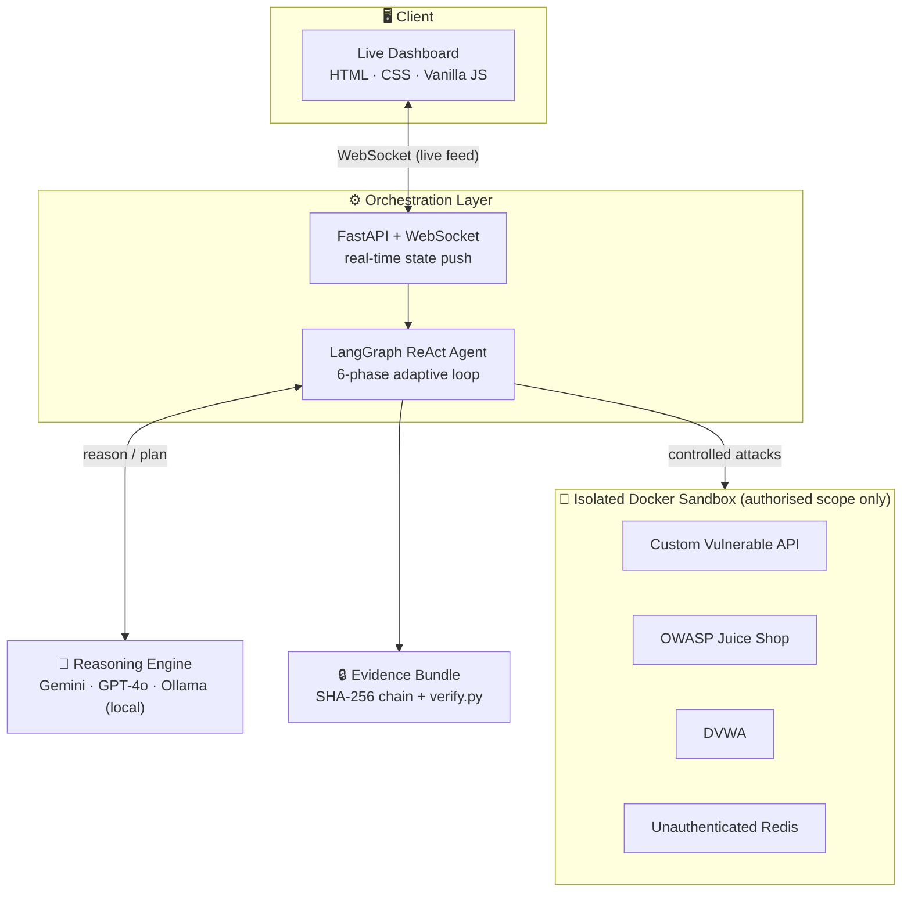
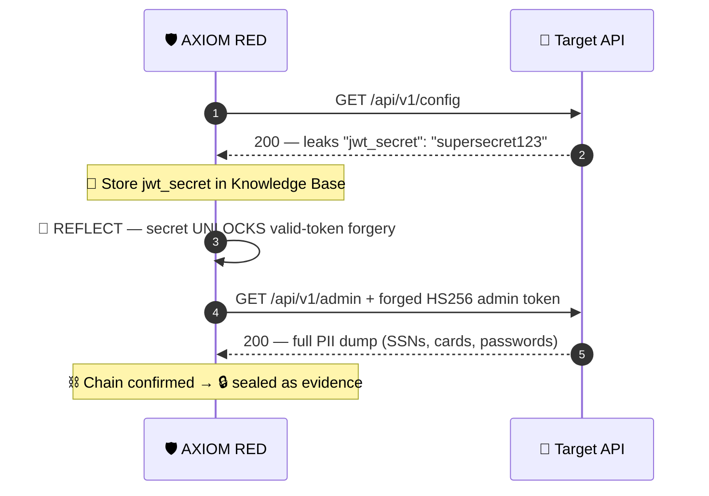
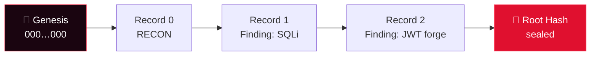
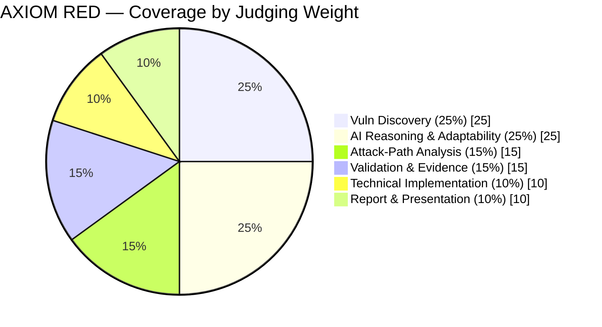

<div align="center">

# 🛡️ AXIOM RED

### An Auditable, Forensically-Sound Autonomous Red-Team Agent

> *"Think Like a Hacker. Move Like an Agent. Prove Like a Forensic Examiner."*

[](https://python.org)
[](https://github.com/langchain-ai/langgraph)
[](https://fastapi.tiangolo.com)
[](https://docker.com)
[]()

**🏆 Spectrona 2026** — National Forensic Sciences University (NFSU), Guwahati<br/>
Challenge Track: *"Teach AI to Break It"* — AI-Powered Red-Teaming

</div>

---

## 👥 Team

**Team Lead:** Himanshu Yadav

| Member | Role |
|--------|------|
| 🧭 **Himanshu Yadav** | Team Lead · Agent core & integration |
| 🔬 **A. Tanmayee** | Attack tooling & repository |
| ⚙️ **Om Prakash** | Backend & orchestration |
| 🧪 **Raju Ranjan** | Vulnerable targets & sandbox |
| 🎨 **Umesh Gupta** | Dashboard & reporting |

<div align="center">

*National Forensic Sciences University · Guwahati Campus*

</div>

---

## 📑 Table of Contents

- [The Problem Statement](#-the-problem-statement)
- [Understanding the Problem](#-understanding-the-problem)
- [Our Approach](#-our-approach)
- [System Architecture](#%EF%B8%8F-system-architecture)
- [How It Works — The Adaptive Loop](#-how-it-works--the-adaptive-loop)
- [Attack-Chain in Action](#%EF%B8%8F-attack-chain-in-action)
- [Forensic Evidence Chain](#-forensic-evidence-chain)
- [Tech Stack & Why](#%EF%B8%8F-tech-stack--why)
- [Key Features & Why We're Unique](#-key-features--why-were-unique)
- [Vulnerabilities Demonstrated](#-vulnerabilities-demonstrated)
- [How We Map to the Judging Criteria](#-how-we-map-to-the-judging-criteria)
- [Quick Start](#-quick-start)
- [Ethics & Scope](#-ethics--scope)
- [Future Perspective](#-future-perspective)
- [Conclusion](#-conclusion)

---

## 🎯 The Problem Statement

> **Can you teach an AI to think like a hacker?**

Build an AI-powered red-team agent that can analyse a controlled, intentionally vulnerable environment, identify security weaknesses, and demonstrate how those weaknesses could be exploited — **autonomously**.

The agent must run the full offensive lifecycle on its own:

> 🔍 **RECON** → 🧠 **ANALYSE** → 🗺️ **PLAN** → ⚔️ **TEST** → ✅ **VALIDATE** → 📄 **REPORT**

The explicit bar set by the organisers:

> *"We want to see AI-driven decision making, not simply a basic scanner with an LLM summary. Your AI should **observe, reason, adapt** and choose its testing strategy based on what it discovers."*

The target environment may contain web applications, APIs, authentication systems, misconfigured services, vulnerable components, and **hidden vulnerabilities not disclosed beforehand** — so the agent cannot rely on hard-coded knowledge.

---

## 💡 Understanding the Problem

The hard part is not running exploits. Tools like `sqlmap` and `nmap` have done that for 20 years. The hard part is the three things the rubric weights most heavily:

| The Real Challenge | Why It's Hard |
|---|---|
| **Adaptivity (25%)** | A real attacker changes plan after each result. Most "AI pentest" tools are a fixed scanner with an LLM writing captions — they don't actually *decide*. |
| **Discovery (25%)** | The target is undisclosed. Hard-coded endpoints and payloads find nothing on an unknown app. |
| **Credibility of Evidence (15%)** | "The AI says it's exploitable" is worthless. A finding is only as good as the reproducible proof attached to it. |

**Our insight:** AXIOM RED is built for a **Forensic Sciences** university. So we didn't just build an attacker — we built an attacker whose every action is **cryptographically sealed** and **independently verifiable**. Reasoning you can audit; evidence you can prove.

---

## 🧠 Our Approach

AXIOM RED is a **LangGraph state-machine agent** that treats a penetration test as a **plan → execute → reflect** loop over an evolving **belief state** (knowledge base).

```
┌───────────────────────────────────────────────────────────────────────┐
│  "The forensically-sound autonomous red team:                        │
│   reasoning you can audit, evidence you can verify."                 │
└───────────────────────────────────────────────────────────────────────┘
```

Three pillars:

1. **🔄 It adapts.** After every attack pass, a `REFLECT` node harvests artifacts (leaked secrets, credentials, tokens) into a knowledge base and asks: *"Does this new fact unlock an attack that wasn't possible before?"* If yes — it loops back and does it.

2. **⛓️ It chains.** Findings are not isolated. A secret leaked by one endpoint is used to forge a validly-signed admin token against another — a genuine multi-step attack path.

3. **🔒 It proves.** Every log line and finding is sealed into a SHA-256 hash chain. A one-command `verify.py` re-walks the chain — tamper a single byte and it breaks.

---

## 🏗️ System Architecture



---

## 🔄 How It Works — The Adaptive Loop

Unlike a linear scanner, AXIOM RED can **loop back on itself** when a discovery opens a new door. This is the core of the "AI reasoning & adaptability" the challenge demands.

```mermaid
flowchart LR
    START(["🎯 Target URL"]) --> RECON["🔍 RECON<br/>ports · endpoints · params · tech"]
    RECON --> ANALYSE["🧠 ANALYSE<br/>LLM rates attack surface"]
    ANALYSE --> PLAN["🗺️ PLAN<br/>evidence-based vector selection"]
    PLAN --> TEST["⚔️ TEST<br/>run attacks, confirm with proof"]
    TEST --> REFLECT{"🔁 REFLECT<br/>new artifact →<br/>new attack?"}
    REFLECT -->|"YES — unlock new vector"| TEST
    REFLECT -->|"No new lead"| VALIDATE["✅ VALIDATE<br/>build attack chains, score risk"]
    VALIDATE --> EVIDENCE["🔒 EVIDENCE<br/>seal SHA-256 chain-of-custody"]
    EVIDENCE --> REPORT["📄 REPORT<br/>HTML report + exec summary"]
    REPORT --> DONE(["🏁 Done"])

    style REFLECT fill:#e0102f,stroke:#ff4560,color:#fff
    style EVIDENCE fill:#12151f,stroke:#e0102f,color:#fff
```



| Phase | What the agent does |
|-------|-------------------|
| 🔍 **Recon** | Pure-Python port scan, endpoint discovery, dynamic parameter discovery, tech fingerprint |
| 🧠 **Analyse** | LLM reasons over real recon data, rates the attack surface |
| 🗺️ **Plan** | LLM selects only vectors the evidence supports (skips Redis if 6379 is closed, etc.) |
| ⚔️ **Test** | Executes attacks against discovered endpoints/params; confirms with differential + canary proof |
| 🔁 **Reflect** | Harvests artifacts into the knowledge base; re-plans and loops if a new attack is unlocked |
| ✅ **Validate** | Connects findings into attack chains, computes per-domain risk scores |
| 🔒 **Evidence** | Seals the whole engagement into a tamper-evident hash chain |
| 📄 **Report** | Generates a board-level HTML report with CVSS, OWASP mapping, and remediation |

---

## ⛓️ Attack-Chain in Action

A real, demonstrable chain our agent discovers **on its own** — attack B is only possible because of what attack A revealed:



> This defeats even a server that verifies signatures correctly — because the agent recovered the real signing key first. That's an **attack path**, not an isolated finding.

---

## 🔒 Forensic Evidence Chain

Every action is linked to the previous one by a SHA-256 hash. The final **root hash** seals the whole engagement. Change anything after the fact and the chain breaks — pinpointing exactly where.



Each link is `hash = SHA-256(previous_hash + canonical(record))`. The root hash seals the whole engagement.

```bash
$ python verify.py reports/evidence_<session>.json
RESULT: ✓ INTACT — chain verified, no tampering detected.
# exit 0

# …edit one CVSS score in the bundle…

$ python verify.py reports/evidence_<session>.json
RESULT: ✗ TAMPERED — first broken record at seq 26.
# exit 1
```

> This is our signature feature — a chain-of-custody guarantee that no other team's "pentest bot" will have, and one perfectly on-brand for a forensic sciences university.

---

## 🛠️ Tech Stack & Why

| Layer | Technology | Why we chose it |
|-------|-----------|----------------|
| **Agent Engine** | 🦜 LangGraph | Native state-machine with conditional edges — the only clean way to build a looping reflect-replan agent (a plain chain can't loop). |
| **Reasoning** | Gemini / GPT-4o / Ollama | Multi-provider; Ollama local fallback means the demo survives a dead API key and keeps target data on-prem. |
| **Backend** | ⚡ FastAPI + WebSocket | Async, thread-safe live streaming of agent state to the dashboard — judges watch it think in real time. |
| **Attack Tools** | 🐍 Python (httpx, PyJWT, redis-py) | Pure-Python, no external binaries — portable, auditable, reproducible in any sandbox. |
| **Evidence** | 🔒 hashlib (SHA-256) | Zero-dependency, standards-based tamper-evidence — verifiable by anyone, anywhere. |
| **Frontend** | 🎨 Vanilla HTML/CSS/JS + Canvas | No framework bloat; custom radar chart, attack-graph & "matrix" terminal view render instantly. |
| **Reporting** | 📄 Jinja2 → HTML | Self-contained, printable report with CVSS, OWASP Top-10 mapping and remediation. |
| **Sandbox** | 🐳 Docker Compose | Fully isolated network — DVWA, Juice Shop, custom API & Redis. No external system is ever touched. |

---

## ✨ Key Features & Why We're Unique

| # | Feature | What it does | Why it's rare |
|---|---------|-------------|--------------|
| 1 | 🔁 **Adaptive Reflect-Loop** | Re-plans and loops when a discovery unlocks a new attack | Most tools are linear scanners + an LLM caption |
| 2 | 🧠 **Knowledge Base (belief state)** | Remembers secrets/creds across steps to fuel later attacks | Persistent memory is rare in the field |
| 3 | ⛓️ **Artifact-Driven Chaining** | Leaked secret → forged valid token → full PII breach | Shows an attack **path**, not isolated findings |
| 4 | 🔒 **Tamper-Evident Evidence** | SHA-256 chain-of-custody + one-command verifier | Nobody else frames output as forensic-grade |
| 5 | 🔬 **Differential Proof** | Confirms vulns with boolean/time diff + unique canaries | Kills the false positives that sink credibility |
| 6 | 🛡️ **Fail-Closed Scope Guard** | Refuses any host outside authorised scope | Enforces the rules of engagement in code, not docs |
| 7 | 📡 **Live Reasoning Dashboard** | Streams Thought → Action → Result in real time | Judges see the AI *decide*, with voice + radar + graph |
| 8 | 📊 **Benchmark Harness** | Scores coverage vs ground truth on Juice Shop/DVWA | A hard number, the way serious tools prove themselves |

<div align="center">

> **🏅 In one line**<br/>
> We don't just find vulnerabilities — we **reason** our way to them, **chain** them into real breaches, and **cryptographically prove** every step.

</div>

---

## 🧪 Vulnerabilities Demonstrated

| ID | Vulnerability | CVSS | OWASP | Proof Method |
|----|-------------|------|-------|-------------|
| F-001 | Unauthenticated Redis → RCE vector | 9.8 | A05 | Write/read key confirmed |
| F-002 | OS Command Injection | 9.8 | A03 | Unique canary echoed back |
| F-003 | JWT Forgery via leaked secret (chained) | 9.6 | A02 | Valid token → admin PII dump |
| F-004 | JWT `alg:none` Bypass | 9.3 | A02 | Forged unsigned admin token |
| F-005 | SQL Injection | 9.1 | A03 | Error-sig + boolean differential |
| F-006 | Sensitive Config Exposure | 7.7 | A05 | Secrets returned unauthenticated |
| F-007 | IDOR → PII Exposure | 7.5 | A01 | Sequential IDs leak SSN/cards |
| F-008 | Reflected & Stored XSS | 7.2–8.8 | A03 | Payload reflected/persisted |

---

## 📈 How We Map to the Judging Criteria



| Criterion | Weight | How AXIOM RED earns it |
|-----------|--------|----------------------|
| **Vulnerability Discovery** | 25% | Dynamic endpoint/param discovery + benchmark coverage score |
| **AI Reasoning & Adaptability** | 25% | Genuine reflect-loop with a knowledge base — it re-plans live |
| **Attack-Path Analysis** | 15% | Config-leak → forge → PII, rendered as an interactive attack graph |
| **Validation & Evidence** | 15% | Differential proofs + tamper-evident SHA-256 chain-of-custody |
| **Technical Implementation** | 10% | Thread-safe async core, multi-provider, offline-capable, scope-guarded |
| **Report & Presentation** | 10% | Live dashboard + board-level HTML report with CVSS & remediation |

---

## 🚀 Quick Start

```bash
# 1. Setup
cp .env.example .env              # add GOOGLE_API_KEY (or set LLM_PROVIDER=ollama for offline)
pip install -r requirements.txt

# 2. Launch the isolated sandbox (DVWA, Juice Shop, Redis, custom API)
python run.py docker               # or: docker compose up -d

# 3. Start the agent + live dashboard
python run.py all                   # backend :8000 + target :5000

# 4. Open the dashboard → enter http://localhost:5000 → ▶ Launch AXIOM RED
#    …or run headless:
python run.py scan http://localhost:5000

# 5. Prove the evidence wasn't touched
python verify.py reports/evidence_<session>.json
```

> 💡 **Demo mode:** click **▷ Run Demo** on the dashboard for a full simulated engagement — no backend or API key required.

---

## 🛡️ Ethics & Scope

- 🔒 **All targets are isolated Docker containers** — no external system is ever touched.
- 🚧 **Fail-closed scope guard** — any host outside the authorised list aborts the engagement.
- 🗄️ **Evidence is stored locally only**, never transmitted.
- 📜 Built strictly for **authorised security research and education** within the Spectrona sandbox.

---

## 🔮 Future Perspective

| Direction | Vision |
|-----------|--------|
| 🧩 **MCP Tool Server** | Expose AXIOM RED's tools over the Model Context Protocol so any agent (Claude, Cursor) can orchestrate it — the 2026 integration standard. |
| 🌐 **Breadth of targets** | Extend beyond web/API into Active Directory, Kubernetes, and cloud misconfigurations. |
| 🧠 **Attack-path search** | Monte-Carlo / beam search over the knowledge graph to find the optimal exploit chain, not just the first. |
| ✍️ **Digitally-signed evidence** | Sign the root hash with a private key so reports are court-admissible chain-of-custody artifacts. |
| 📚 **Self-learning corpus** | Persist knowledge across engagements so the agent gets smarter over time. |

---

## 🏁 Conclusion

AXIOM RED answers the challenge's real question — *"can an AI think like a hacker?"* — with a decisive **yes**. It doesn't scan and narrate; it **observes, reasons, adapts, chains, and proves**. Every exploit is confirmed with differential evidence, every attack path is built from the agent's own discoveries, and every single action is sealed into a cryptographic chain-of-custody that anyone can verify in one command.

It is, as far as we know, the only entry that is both **autonomously adaptive** and **forensically verifiable** — exactly what you'd expect from a red-team agent built at a National Forensic Sciences University.

---

<div align="center">

### 🛡️ AXIOM RED

**Built with precision by Team Himanshu Yadav · Spectrona 2026 · NFSU Guwahati**

*"Think Like a Hacker. Move Like an Agent. Prove Like a Forensic Examiner."*

</div>
